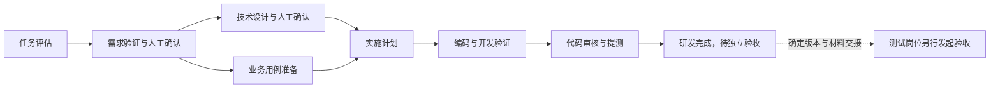

# SDD Workflow Skills

面向 Codex、Claude Code 和 Cursor 的通用 SDD 研发交付技能套件。

当前套件版本为 **0.3.0**，操作手册为 **1.1**。它支持新功能、功能扩展和 Bug 分流，覆盖需求验证、技术设计、开发验证、代码审核、提测交接及测试岗位独立验收。

## 流程与岗位



新增功能和扩展走完整 SDD。Bug 依据预期、根因、影响、风险和可验证性选择直接修复或适当阶段切入。需求与设计在既定节点由用户确认，重大偏差重新对齐。

研发在 mock／隔离环境充分执行所需单元、接口、非 UI 功能和契约测试，代码归各前后端项目 `test/`。全部 UI 执行、真实依赖集成和部署 E2E 由测试岗位在独立验收工程组织。

## 技能目录

| Skill | 用途 |
| --- | --- |
| [sdd-workflow](skills/sdd-workflow/SKILL.md) | 研发交付入口，推进到提测交接 |
| [sdd-triage](skills/sdd-triage/SKILL.md) | 任务评估、简单 Bug 准入与复杂问题切入 |
| [sdd-requirement-validation](skills/sdd-requirement-validation/SKILL.md) | 需求合理性、闭环、边界与可验收检查 |
| [sdd-design](skills/sdd-design/SKILL.md) | 可实施设计、契约、状态、失败及正确性约束 |
| [sdd-test-cases](skills/sdd-test-cases/SKILL.md) | 两岗位分别设计可追溯用例 |
| [sdd-plan](skills/sdd-plan/SKILL.md) | 拆分有依赖、可验证的实施任务 |
| [sdd-implement](skills/sdd-implement/SKILL.md) | 编码、针对性开发验证与作者自查 |
| [sdd-review-code](skills/sdd-review-code/SKILL.md) | 核对实际改动、风险和验证证据 |
| [sdd-acceptance](skills/sdd-acceptance/SKILL.md) | 测试岗位独立准备、执行验收与复测 |

需求澄清按需引用随套件保留的 [grilling](skills/grilling/SKILL.md)，相关来源记录见 [DEPENDENCIES.md](DEPENDENCIES.md)。

## 安装与使用

下载或克隆仓库后，将 `skills/` 下的九个 `sdd-*` 目录及 `grilling` 目录安装到目标工具的技能目录。也可将技能目录链接到本仓库，统一维护源文件。保留各目录之间的相邻关系，供相对引用解析。

| 工具 | 本套件使用过的个人技能目录 |
| --- | --- |
| Codex | `~/.codex/skills/` |
| Claude Code | `~/.claude/skills/` |
| Cursor | `~/.cursor/skills/` |
| 共享发现位置 | `~/.agents/skills/` |

实际目录与技能发现方式以当前宿主配置为准。同名安装项应先核对其来源及内容，再选择复制或链接的位置。将一份完整套件作为维护源，可以减少多个工具分别修改造成的漂移。

研发任务可以这样描述。

> 请读取并按 sdd-workflow 推进这个任务。目标工程和需求在所附材料中。先核实事实与范围，在既定需求和设计节点由我确认，完成开发验证、代码审核及提测交接。

测试岗位可以这样描述。

> 请以测试岗位按 sdd-acceptance 接收这次交付。独立验收工程、待测构建和材料已指定。本次范围为用例准备／验收执行，请按实际条件记录结果。

技能引用表示读取并应用对应 `SKILL.md`。各工具的具体调用语法与可用能力按实际宿主使用。

## 产物与知识管理

用户指定位置和项目现有约定优先。新项目默认采用以下结构。

```text
features/v<版本>/<主模块>/<编号>-<特性名>/
  feature.yaml
  requirements.html
  design.html
  test-cases.html
  tasks.md
  state.md
  handoff.md
```

各阶段共用有效登记与稳定标识。版本未定可归 `_unplanned`，跨模块变更由一个主模块保管并关联受影响模块。现有平铺目录和分散的有效文档可通过登记接续。

正式需求、设计与用例使用 HTML。已交付基线、后续关联变更、现行模块知识和每次运行证据按各自生命周期维护。完整约定与登记模板见 [产物存放规范](skills/sdd-workflow/references/artifact-storage.md) 和 [feature-template.yaml](skills/sdd-workflow/assets/feature-template.yaml)。

## 手册、模板与版本清单

- [SOP HTML 手册 1.1](docs/sdd-sop-v1.1.html)，下载后在浏览器中打开，可离线阅读。
- [技术设计 HTML 模板](skills/sdd-design/assets/design-template.html)。
- [技能版本与文件指纹](bundle-manifest.json)。
- [验证范围](docs/verification.md)。

手册第 14 章保留编写时的个人安装布局。安装本仓库时，以本页说明及当前工具配置解析技能位置。
