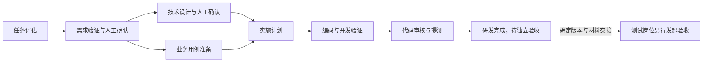

# SDD Workflow Skills

面向主流 Agent 工具的通用 SDD 研发交付技能套件，支持通过命令安装完整技能包。

当前仓库版本为 **0.4.0**，流程手册为 **1.2**。它支持新功能、功能扩展和 Bug 分流，覆盖需求验证、技术设计、开发验证、代码审核、提测交接及测试岗位独立验收。

## 命令安装

使用 Node.js **22.20.0 或更新版本**，通过固定验证版本的 [skills CLI](https://github.com/vercel-labs/skills) 安装。例如，全局安装到 Codex。

```bash
npx skills@1.7.6 add likaiaki/sdd-workflow-skills --skill '*' --agent codex --global
```

同时安装到多个工具。

```bash
npx skills@1.7.6 add likaiaki/sdd-workflow-skills --skill '*' --agent codex claude-code cursor opencode gemini-cli github-copilot --global
```

在目标项目中省略 `--global` 即为项目安装。Cursor 也支持这条命令安装路径。`--skill '*'` 会带上全部九个 SDD skill、`grilling` 和 `domain-modeling`，使跨技能引用完整。

支持 Codex、Claude Code、Cursor、OpenCode、Gemini CLI、GitHub Copilot、Amp、Windsurf、Roo Code、Continue、Kiro CLI、Qoder、Trae、Qwen Code 和 Kimi Code CLI 的安装目录适配。Cline 与新版 Antigravity 的明确目录安装方式也已提供。

安装会重建所选范围内的同名技能目录，已有本地修改应先备份核对。多个工具共享 `.agents/skills` 时，更新和移除也会影响读取该目录的其他工具。

更多 Agent 标识、GitHub CLI 安装、固定提交、更新和卸载见 [命令安装指南](INSTALL.md)。

## 流程与岗位



新增功能和扩展走完整 SDD。Bug 依据预期、根因、影响、风险和可验证性选择直接修复或适当阶段切入。需求与设计在既定节点由用户确认，重大偏差重新对齐。

研发在 mock／隔离环境充分执行所需单元、接口、非 UI 功能和契约测试，代码归各前后端项目 `test/`。全部 UI 执行、真实依赖集成和部署 E2E 由测试岗位在独立验收工程组织。

## 技能目录

| Skill | 用途 |
| --- | --- |
| [sdd-workflow](skills/sdd-workflow/SKILL.md) | 研发交付入口，推进到提测交接 |
| [sdd-triage](skills/sdd-triage/SKILL.md) | 任务评估、简单 Bug 准入与复杂问题切入 |
| [sdd-requirement-validation](skills/sdd-requirement-validation/SKILL.md) | 需求合理性、闭环、边界与可验收检查 |
| [sdd-design](skills/sdd-design/SKILL.md) | 可实施设计、契约、状态、失败及正确性约束 |
| [sdd-test-cases](skills/sdd-test-cases/SKILL.md) | 两岗位分别设计可追溯用例 |
| [sdd-plan](skills/sdd-plan/SKILL.md) | 拆分有依赖、可验证的实施任务 |
| [sdd-implement](skills/sdd-implement/SKILL.md) | 编码、针对性开发验证与作者自查 |
| [sdd-review-code](skills/sdd-review-code/SKILL.md) | 核对实际改动、风险和验证证据 |
| [sdd-acceptance](skills/sdd-acceptance/SKILL.md) | 测试岗位独立准备、执行验收与复测 |

需求澄清按需引用随套件保留的 [grilling](skills/grilling/SKILL.md)，概念新增或冲突时按需使用 [domain-modeling](skills/domain-modeling/SKILL.md)，相关来源与适配记录见 [DEPENDENCIES.md](DEPENDENCIES.md)。

## 使用

使用命令安装后，在目标工具中选择 `sdd-workflow` 开始研发，或以测试岗位选择 `sdd-acceptance`。实际发现位置和调用方式见安装指南及工具当前配置。

研发任务可以这样描述。

> 请读取并按 sdd-workflow 推进这个任务。目标工程和需求在所附材料中。先核实事实与范围，在既定需求和设计节点由我确认，完成开发验证、代码审核及提测交接。

测试岗位可以这样描述。

> 请以测试岗位按 sdd-acceptance 接收这次交付。独立验收工程、待测构建和材料已指定。本次范围为用例准备／验收执行，请按实际条件记录结果。

技能引用表示读取并应用对应 `SKILL.md`。各工具的具体调用语法与可用能力按实际宿主使用。

## 产物与知识管理

用户指定位置和项目现有约定优先。新项目默认采用以下结构。

```text
features/v<版本>/<主模块>/<编号>-<特性名>/
  feature.yaml
  requirements.html
  design.html
  test-cases.html
  tasks.md
  state.md
  handoff.md
```

各阶段共用有效登记与稳定标识。版本未定可归 `_unplanned`，跨模块变更由一个主模块保管并关联受影响模块。现有平铺目录和分散的有效文档可通过登记接续。

正式需求、设计与用例使用 HTML。已交付基线、后续关联变更、现行模块知识和每次运行证据按各自生命周期维护。完整约定与登记模板见 [产物存放规范](skills/sdd-workflow/references/artifact-storage.md) 和 [feature-template.yaml](skills/sdd-workflow/assets/feature-template.yaml)。

## 领域语言与质量闭环

需求、设计、用例、任务和代码沿用相同的术语基线及本次已确认概念增量。项目已有词典优先；业务定义与技术标识建立必要映射，旧接口名可按兼容关系保留。候选、确认目标和代码现状分别记录，旧构建继续使用对应基线，详见 [领域语言接入](skills/sdd-workflow/references/domain-language.md)。

复杂 Bug 围绕用户原症状建立有界反馈；关键断言使用独立预期。代码审核区分需求／设计与项目规范，明确提交及工作区的实际范围，并保留全部适用风险检查与修复复核。普通任务复用有效结果，只在有依据时增加 ADR、原型、环境检查或复盘。

## 手册、模板与版本清单

- [SOP HTML 手册 1.2](docs/sdd-sop-v1.2.html)，下载后在浏览器中打开，可离线阅读。
- [技术设计 HTML 模板](skills/sdd-design/assets/design-template.html)。
- [技能版本与文件指纹](bundle-manifest.json)。
- [验证范围](docs/verification.md)。

当前跨 Agent 命令与目录适配统一维护在 [INSTALL.md](INSTALL.md)。旧版手册保留历史基线，实际使用以 1.2 和当前技能为准。
